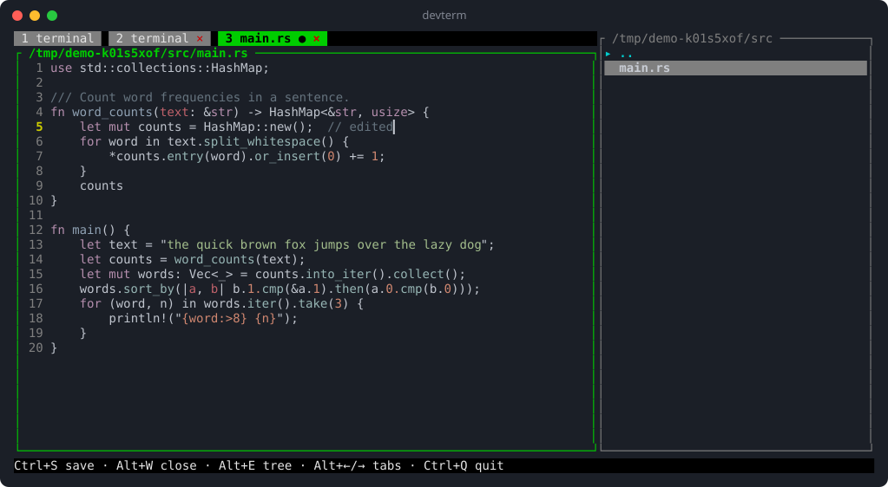

<div align="center">

# devterm

**A terminal laid out like a code editor.**
Real shells and editor tabs on the left, a live file tree on the right — in one terminal window.

[](https://github.com/CyberShuriken/DevTerminal/actions/workflows/ci.yml)
[](LICENSE)




</div>

---

## Why

Editors like VS Code give you files, tabs and a terminal side by side. devterm
brings that layout to any terminal — over SSH, in a TTY, inside tmux — as a
single fast, native Rust binary with no runtime.

## Features

| | |
| --- | --- |
| 🖥️ **Real terminals** | Your `$SHELL` in a PTY: `vim`, `htop`, `git`, `ssh` all work. 5000 lines of scrollback. `Alt+T` opens more shell tabs. |
| 📝 **Editor tabs** | Open any file from the tree. Syntax highlighting for 150+ languages, line numbers, auto-indent, smart Home, `Ctrl+S` to save, `●` for unsaved changes. |
| 🌲 **Live file tree** | `cd` in a shell and the tree follows. Folders first, case-insensitive sorting, unreadable folders skipped. |
| 🖱️ **Mouse support** | Click files, tabs and `×`; click to place the editor cursor; wheel-scroll the tree, editor and terminal scrollback. |
| 🛡️ **Safe by default** | Keeps your line endings (LF/CRLF) and trailing newline; refuses binary, non-UTF-8 and >8 MB files; warns before discarding unsaved work. |
| ⚡ **Light** | Redraws only when something changes; highlighting is incremental and limited to what's on screen. |

## Install

Requires a [Rust toolchain](https://rustup.rs) (1.88+) and Linux.

```bash
cargo install --git https://github.com/CyberShuriken/DevTerminal
```

Or build from source:

```bash
git clone https://github.com/CyberShuriken/DevTerminal
cd DevTerminal
cargo build --release
./target/release/devterm
```

## Usage

```bash
devterm              # open in the current directory
devterm ~/project    # open in a given directory
```

You start in the terminal tab. Press `Alt+E` to jump to the file tree, pick a
file and press `Enter` — it opens as a new tab.

> [!TIP]
> devterm captures the mouse, so hold **Shift** while dragging to select and
> copy text with your terminal emulator.

## Keybindings

Global shortcuts use `Alt` so they never steal keys your shell needs.

| Key | Action |
| --- | --- |
| `Ctrl+Q` | Quit (press twice if a file is unsaved) |
| `Alt+E` | Toggle focus: tabs ⇄ file tree |
| `Alt+T` | New terminal tab |
| `Alt+←` / `Alt+→` | Previous / next tab |
| `Alt+1` … `Alt+9` | Jump to tab |
| `Alt+W` | Close tab (press twice if unsaved; tab 1 can't be closed) |
| `Ctrl+S` | Save (editor tabs only; in a terminal it goes to the shell) |

<details>
<summary><b>File tree, terminal and editor keys</b></summary>

**File tree**

| Key | Action |
| --- | --- |
| `j` / `k`, `↓` / `↑` | Move |
| `Enter`, `l`, `→` | Open folder / open file in a tab |
| `h`, `←`, `Backspace` | Go up a folder |

**Terminal** — every other key goes to the shell; typing snaps scrollback back
to the bottom. If the shell exits, press `Enter` to restart it.

**Editor**

| Key | Action |
| --- | --- |
| Arrows, `PgUp` / `PgDn` | Move (remembers the column) |
| `Home` / `End` | Smart line start / line end |
| `Ctrl+Home` / `Ctrl+End` | Start / end of file |
| `Tab` | Indent with a tab or spaces, matching the file |
| `Enter` | New line with auto-indent |
| `Backspace` / `Delete` | Delete, joining lines at the edges |

</details>

## How it works

```
src/
├── main.rs       terminal setup/teardown, panic hook, event loop
├── app.rs        state, focus, tabs, keybindings, mouse routing
├── ui.rs         layout: tab bar + content │ file tree, status bar
├── terminal.rs   $SHELL in a PTY (portable-pty) → vt100 screen → ratatui buffer
├── keys.rs       key events → xterm byte sequences
├── editor.rs     text buffer, editing, rendering
├── highlight.rs  incremental syntect highlighting with a per-line state cache
└── tree.rs       directory listing for the file tree
```

- Each shell runs in its own PTY; a reader thread feeds output into a
  [`vt100`](https://crates.io/crates/vt100) parser, which is drawn cell by
  cell into the [ratatui](https://ratatui.rs) buffer.
- The tree follows the active shell by polling `/proc/<pid>/cwd` every 400 ms.
- [`syntect`](https://crates.io/crates/syntect) is built with its pure-Rust
  regex engine, so there are no C dependencies.

## Known limitations

- **Linux only** for now — live folder sync reads `/proc`.
- The tree follows the shell devterm started. After `ssh`, a nested shell or
  `su`, it stays on the outer shell's folder.
- Mouse wheel scrolls devterm's scrollback, so it isn't passed to full-screen
  apps like `vim` or `htop`.
- Closing a terminal tab kills its shell without asking.

## Roadmap

- [ ] Forward mouse events to full-screen terminal apps
- [ ] Undo/redo, search, selection and clipboard in the editor
- [ ] Expandable folders; create, rename and delete files from the tree
- [ ] Resizable split and a config file
- [ ] macOS support

## Contributing

Issues and pull requests are welcome — see [CONTRIBUTING.md](CONTRIBUTING.md).

## License

[MIT](LICENSE) © 2026 Simanto
